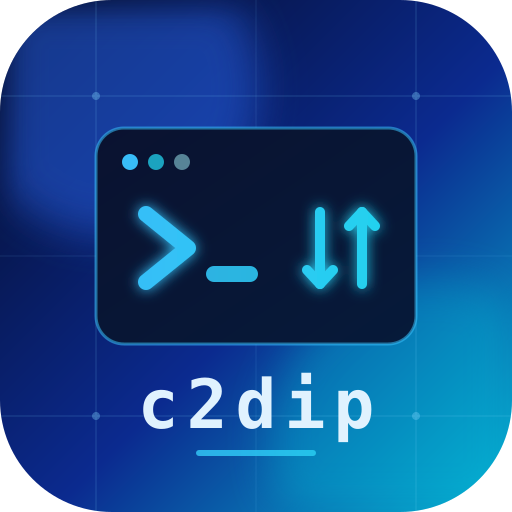

# c2dip

c2dip is an encrypted two-way command and small-file channel over the DeepSeek Files API. Each channel uses separate asymmetric keys, and runtime HTTP connects directly only to `api.deepseek.com`.

Build the sender with `bash scripts/build-sender.sh`, then create a channel with `./c2dip-sender init --channel lab`. Give each endpoint only its own generated key bundle.

Build a zero-setup receiver with `DEEPSEEK_API_KEY='key' bash scripts/build-receiver.sh .c2dip/keys/lab/receiver.json`, then run `./c2dip-receiver`; embedded credentials are extractable from the binary. Set `DEEPSEEK_API_KEY` on the client and run `./c2dip-sender --channel lab`.
